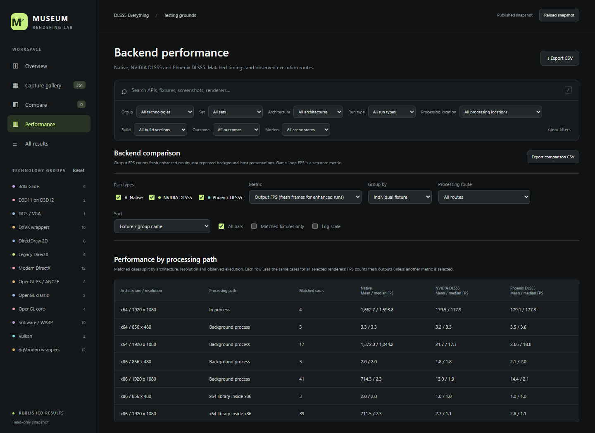
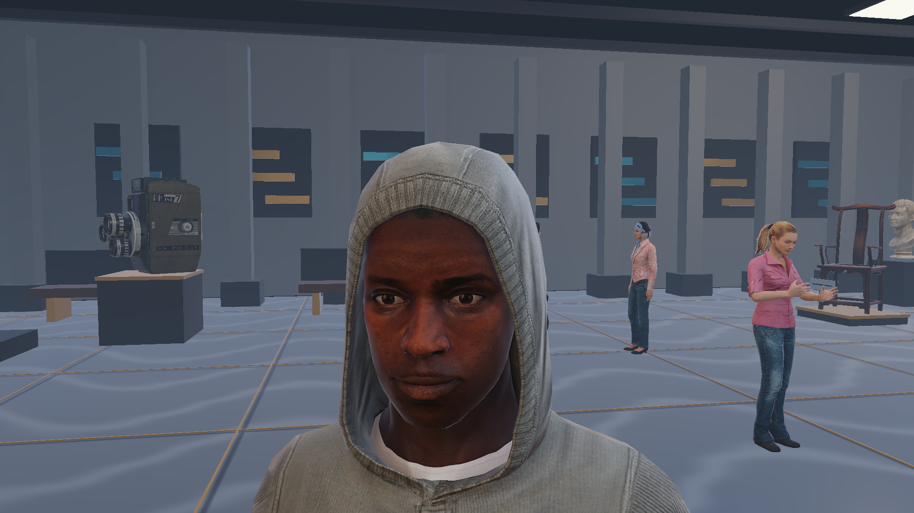
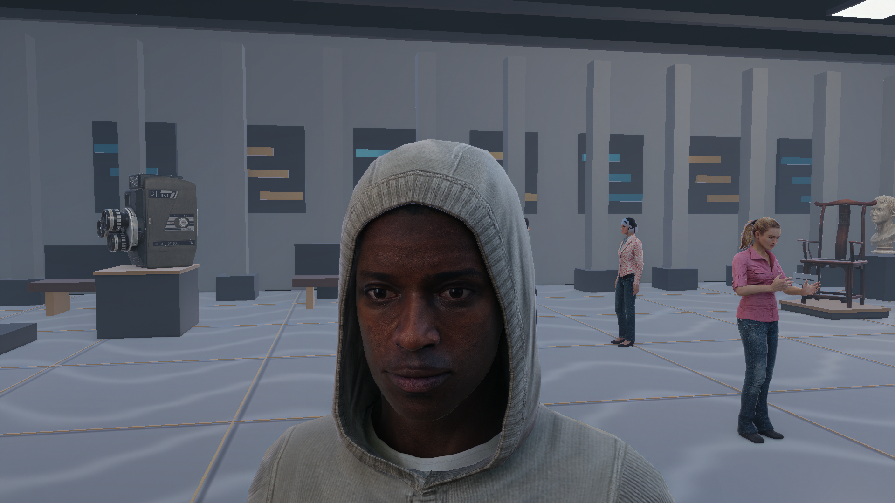

# Museum Lab: Graphics APIs, Phoenix DLSS5 and NVIDIA DLSS5

**One museum scene, 82 Windows rendering fixtures, and a DOS VGA bonus. Explore how rendering paths differ on the same hardware, then measure what happens when neural rendering is added.**

[**Open the interactive dashboard**](https://razvanmanolache.github.io/dlss5-everything-testing/dashboard/index.html#performance) | [All 445 results as CSV](docs/dashboard/results.csv) | [Measured summary](docs/dashboard/summary.json) | [Build and run](docs/development.md)

## Two Questions, One Test Scene

1. **How does the rendering path change the result?** Compare implementations of the same scene through legacy DirectX, DirectDraw, Glide, modern Direct3D, OpenGL, OpenGL ES, Vulkan, translation layers and software rendering. Repeat the suite after code or driver updates to see which paths improve or regress.
2. **Can neural rendering actually reach the screen?** Exercise [DLSS5 Everything](https://github.com/RazvanManolache/DLSS5-Everything) and the [Phoenix DLSS5 add-on](https://github.com/RazvanManolache/dlss5-phoenix-addon) across x86/x64 applications, native execution and a background helper. Verify the deployed hook, actual execution route, fresh processed output and changed pixels.

These are **graphics API fixtures, not commercial game-engine benchmarks**. The scene and camera are shared, but shaders, CPU work, submission, presentation and wrapper paths differ. That makes the suite useful for studying implementations and compatibility; it does not isolate the intrinsic speed of an API or recreate the performance of historical games.

## Current Results

Measured on **17-18 October 2026**, using an **NVIDIA GeForce RTX 5080, driver 616.64**, on an AMD Ryzen 9 9950X3D system. Enhanced runs use a locally fixed **0.81-derived Phoenix DLSS5 candidate**. Executable, add-on and model hashes identify the measured inputs; these are not necessarily the binaries from an earlier release bearing that version.

| Check | Passed | Failed | Not applicable |
| --- | ---: | ---: | ---: |
| Clean Windows baselines | 82 | 0 | 0 |
| x64 NVIDIA DLSS5 + Phoenix DLSS5 | 48 | 18 | 0 |
| x86 renderers across requested execution paths | 218 | 27 | 49 |
| Separate DOS baseline / NVIDIA DLSS5 / Phoenix DLSS5 checks | 3 | 0 | 0 |
| **Total records** | **351** | **45** | **49** |

Every successful record has one capture. Failed records retain their reason, **not an image or an FPS score**. NVIDIA's native x86 graph-host route is not applicable: there is no NVIDIA DLSS5 x86 graph implementation to run through it.

### What the API Comparison Shows

The same GPU does not produce the same throughput through every implementation. Selected **clean, unenhanced** results:

| Fixture | Architecture | Recorded game FPS |
| --- | --- | ---: |
| Direct3D 9 | x64 | 1,901.79 |
| Direct3D 10 | x64 | 2,461.07 |
| Direct3D 11 | x64 | 2,437.52 |
| Direct3D 12 | x64 | 1,536.87 |
| D3D11-on-12 | x64 | 1,926.47 |
| OpenGL classic | x64 | 128.75 |
| OpenGL 3.3 core | x64 | 1,044.16 |
| OpenGL 4.6 core | x64 | 1,032.90 |
| Vulkan | x64 | 140.09 |
| DX11 through DXVK | x64 | 959.79 |

**Newer is not automatically faster in this implementation.** DX11 exceeds DX12 here; core OpenGL greatly exceeds the classic path. These are observations about this renderer, driver and presentation strategy, not universal rankings. For example, the Vulkan fixture waits for its queue each frame, and the DX12 fixture waits on a fence each frame. This is small, inspectable test code, not a fully pipelined production engine.

**Translation is a distinct workload.** Native DX11 and DXVK DX11 render the same scene but use different driver stacks. Compare application API, wrapper and observed capture API separately. Some ANGLE Vulkan configurations present through a DirectX surface; their labels preserve that distinction.

**Do not put everything into one hardware-API league table.** DirectDraw 2D rasterizes on the CPU and then blits surfaces. WARP is software rendering. Older Direct3D fixtures include CPU clipping/projection; Glide has a different framebuffer size. DOS has a different renderer, resolution and clock. These families remain separately filterable.

### Phoenix DLSS5 and NVIDIA DLSS5: Where Execution Matters

Mean **fresh completed enhanced outputs per second**, using the same successful fixtures across all required paths *within each renderer*:

| Renderer | Execution path | Matched fixtures | Mean output FPS |
| --- | --- | ---: | ---: |
| Phoenix DLSS5 | **External x64 helper** | 43 | **13.84** |
| Phoenix DLSS5 | x64 library inside x86 | 43 | 2.71 |
| Phoenix DLSS5 | x86 Phoenix DLSS5 + native driver | 43 | 2.68 |
| NVIDIA DLSS5 | **External x64 helper** | 43 | **12.22** |
| NVIDIA DLSS5 | x64 library inside x86 | 43 | 2.59 |

**The helper wins overall for x86 throughput.** It is fastest or within 1% of the fastest in 37 of the 43 matched fixtures for each renderer. In-process paths win a few very slow cases, so they remain useful compatibility alternatives. The renderers' 43-fixture sets differ slightly: do not calculate a head-to-head renderer speedup by dividing these means.

For a modern example, **DX12 x86 / Phoenix DLSS5** delivers **58.15 output FPS** through the helper, **6.65** with the x64 library inside x86, and **6.58** through the x86 driver route. Transport, conversion and synchronization can dominate the pipeline even when neural GPU evaluation is much faster. **1000 / output FPS is an output interval, not isolated GPU inference latency.**

The dashboard provides properly paired Phoenix DLSS5/NVIDIA DLSS5 comparisons, FPS-loss bars, route rankings, sampled timelines, failure filters and per-fixture exports. Phoenix DLSS5 is not universally faster, and throughput is not a visual-quality score. Helper and in-process captures differ: this is **not a proven equal-quality comparison**. Frozen screenshots also do not establish temporal quality in motion.

**Read performance by path, not as one universal average.** The dashboard leads with mean and median output FPS split by architecture, resolution and execution path, with a further technology breakdown. Slow legacy/wrapper cases and experimental x86 routes remain in the dataset, but are not blended into the headline for native in-process execution. Pooled compatibility averages remain available separately. In this snapshot, Phoenix DLSS5 averages **179.1 fresh outputs/s across four matched in-process cases**, versus **16.7 across all 110 matched fixture/path cases**. These are different workloads, not competing estimates of typical game FPS.

### Changes and Remaining Failures

- x64 compatibility stayed at the previous snapshot's 48 enhanced passes and 18 failures. In-process median output rates changed by about 1%; helper medians were approximately 7-11% lower. Clean Windows baseline median FPS changed by -2.8%. Single serial runs show differences, not statistically proven regressions.
- **35 failures** are WARP cases: missing ReShade/Phoenix DLSS5 initialization, readiness timeouts or native allocation/device failures.
- **8 failures** are the two renderers on four unsupported x64 DirectDraw 2D fixtures.
- **2 failures** are x86 library allocation errors: Phoenix DLSS5 with dgVoodoo DX8, and NVIDIA DLSS5 with dgVoodoo DX9. Their helper runs pass.
- Some Vulkan and DXVK DX8/9 paths produce changed output at **less than one fresh frame per second**. A compatibility pass is not a claim of playable speed.
- The optional native x86 runtime was copied by a hash-verified runner supplement after normal installer deployment. That step is **not yet an installer capability**.

## See the Output

The same frozen **DX12 x64** scene, with processing labels rather than quality judgments. Open an image at full resolution, or use the dashboard's side-by-side, wipe and pixel-difference views.

| Clean native | NVIDIA DLSS5 | Phoenix DLSS5 |
| --- | --- | --- |
|  |  |  |

**351 capture records, only 88 distinct image files.** Pixel-identical captures share a content-addressed, lossless WebP. All fixture/renderer/route identities remain intact, even when records reference the same pixels. No approximate similarity threshold discards a genuine difference. Raw image metadata, machine paths, process IDs, logs, tokens and runtime/model binaries are not published.

## Measurement Rules

- Windows runs are sequential: **5 seconds of fixture warmup, then 20 measured seconds**, with a frozen scene/camera and VSync requested off.
- Windows target **1920x1080**, except native Glide at **856x480**. Slow frames can extend a window to a frame boundary; FPS uses its recorded actual duration.
- Clean and working executable hashes match. A wrapper fixture's clean baseline retains its declared factory wrapper, but no neural add-on.
- Enhanced Windows FPS counts fresh completed outputs, not repeated game frames or a helper's swapchain FPS. Game-loop FPS is a separate metric.
- Execution mode and inference-process identity are checked. An explicit native route cannot silently score a helper fallback under its own name.
- Phoenix DLSS5 uses eight blocks, one repeat per block, one refinement pass, native execution, 1:1 resolution and no automatic workload reduction.
- Startup extending past five fixture seconds is labeled **Startup in measurement**. Such scores include initialization; they are not steady-state model timings.
- DOS remains **320x200**. Native FPS uses the emulated guest clock; enhanced rates use host wall time with VSync. They are separate compatibility evidence, not a matched native-loss or Windows performance comparison.

See [the complete protocol](docs/execution-sweep.md), [FPS accounting](docs/processing-fps.md), and [DOS clock distinctions](docs/dos-fps.md). The public [snapshot manifest](docs/dashboard/manifest.json) records image hashes and deduplication; [summary JSON](docs/dashboard/summary.json) includes cohort statistics and previous-score comparisons.

## Explore and Repeat

The [hosted dashboard](https://razvanmanolache.github.io/dlss5-everything-testing/dashboard/index.html) needs no installation and never starts games. A checkout can open `docs/dashboard/index.html` as an offline snapshot. `Dashboard.cmd` indexes your own local results on localhost without uploading them.

There are **49 x86 and 33 x64 Windows fixtures**, plus DOS: DirectX 2/3/5/6/7/8/9/9Ex/10/10.1/11/12, DirectDraw 1/2/4/7 surfaces, Glide, OpenGL classic/core, GLES through ANGLE, D3D11-on-12, WARP, dgVoodoo and DXVK variants. [The matrix](matrix.json) and [fixture definitions](tools/variants.py) record the combinations; not every API exists in both architectures.

[Build and rerun instructions](docs/development.md) explain the separate scene, SDK and licensed-runtime requirements. No GPU tests are needed to browse or export existing evidence. Future measurements should preserve the workload and record changed inputs, rather than suggesting historical captures validate new binaries.

## Credits and Resources

Thanks to the projects that make this comparison possible:

- [DLSS5 Everything](https://github.com/RazvanManolache/DLSS5-Everything) and [Phoenix DLSS5](https://github.com/RazvanManolache/dlss5-phoenix-addon): installation, compatibility and reconstructed neural rendering.
- [NVIDIA DLSS](https://github.com/NVIDIA/DLSS) and [Streamline](https://github.com/NVIDIAGameWorks/Streamline): NVIDIA DLSS5 integration.
- [ReShade](https://github.com/crosire/reshade) and [d3d8to9](https://github.com/crosire/d3d8to9): injection infrastructure and DX8 declarations.
- [dgVoodoo2](https://github.com/dege-diosg/dgVoodoo2), [DXVK](https://github.com/doitsujin/dxvk), [ANGLE](https://github.com/google/angle) and [Electron's ANGLE distribution](https://github.com/electron/electron): translation runtimes.
- [Microsoft Direct3D documentation](https://learn.microsoft.com/en-us/windows/win32/direct3d), [D3D11-on-12](https://learn.microsoft.com/en-us/windows/win32/direct3d12/direct3d-11-on-12), [Vulkan headers](https://github.com/KhronosGroup/Vulkan-Headers), [WOW64Ext](https://github.com/rwfpl/rewolf-wow64ext) and [nlohmann/json](https://github.com/nlohmann/json): APIs and supporting code.
- [DOSBox Staging](https://github.com/dosbox-staging/dosbox-staging), [DOSBox Pure](https://github.com/schellingb/dosbox-pure), [DJGPP](https://www.delorie.com/djgpp/) and [CWSDPMI](https://sandmann.dotster.com/cwsdpmi/): DOS tooling.
- [Microsoft Rocketbox](https://github.com/microsoft/Microsoft-Rocketbox) and [Poly Haven](https://polyhaven.com/): characters and exhibits. [Screenshot credits and license notice](docs/SCREENSHOT-CREDITS.md).

Package versions and available hashes are in the vendor manifests. Third-party sources retain their own licenses. This synthetic showcase is not vendor endorsement or blanket retail-game compatibility certification.
